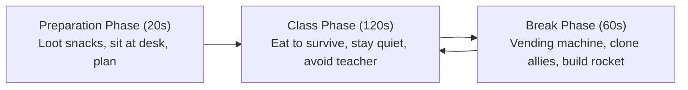

# Cosmic Detention — CSSA Game Jam 2026


> **"Survive alien detention, sneak snacks behind the teacher's back, ragdoll your friends, and build a rocket to escape back to Earth!"**

**Cosmic Detention** is a hilarious first-person LAN co-op stealth and physical comedy game built in 48 hours for the **CSSA Game Jam 2026** (Theme: **Cosmos**). Designed for 2–6 players, abducted human students are trapped in an alien classroom on a lunar base. To survive, you must keep your stomach full without alerting your shotgun-wielding alien teacher. Sneak food, frame your classmates, throw furniture, spend Bitcoin at the vending machine, and piece together a Falcon 9 rocket to stage your cosmic getaway.

---

## Key Features

- **Co-op Stealth & Noise Simulation**:
  - The teacher conducts class at the chalkboard, turning around to investigate suspicious sounds or deliver disciplinary shotgun blasts.
  - Every action produces gameplay noise: footsteps, sprinting, chewing crunchy snacks, slurping drinks, impacts, burps, sneezes, and gas.
  - Blame is dynamic! Loud noises attract suspicion toward locations; unseen infractions can frame nearby students or NPC clones.
- **Hunger & Health Survival**:
  - A single Stomach meter doubles as your life bar. Starvation will kill you, and eating food is your only replenishment.
  - High-tier foods restore health but produce louder crunches and distinct bodily consequences (like explosive gas).
- **Physical Comedy & Six-Body Ragdolls**:
  - Hold, carry, and throw anything: food, props, chairs, NPC student clones, or even your fellow players.
  - Knocked-out or shot players collapse into full physical ragdolls that can be dragged, tossed, and recovered.
- **Vending Economy & Bitcoin Allowance**:
  - Earn Bitcoin allowances by surviving classes and keeping yourself nourished.
  - Spend Bitcoin at the physical vending machine featuring graded snack unlocks (Grade 1 through Grade 4). Purchases physically clatter into the dispensing tray.
- **Cloning & Debt System**:
  - Death is never the end! Deceased players spectate the class in grayscale ghost mode with audio intact.
  - When the bell rings, surviving players can pay a Bitcoin fee at the cloning chute to respawn fallen teammates. Going into debt is allowed—survival comes first!
- **Endless Progression & The Lunar Falcon 9 Escape**:
  - Survive rounds to unlock rocket parts and assemble the multi-stage SpaceX Falcon 9 rocket on the exterior lunar pad.
  - Initiating launch triggers a multi-stage cinematic rocket takeoff complete with authentic mission audio, thruster particles, and soundtrack.
- **Toon Cel Shading & Retro Style**:
  - Real-time custom cel-shading pass with screen-space outlines, distance-scaled line thickness, and dynamic lighting transitions between the indoor classroom and lunar exterior.
- **Interactive Lobby Blooper TV**:
  - A cosmetic wall TV in the pre-game lobby that dynamically plays team bloopers, photos, and game-jam development memories.

---

## Gameplay Loop

A standard session proceeds through distinct structured phases:



- **Preparation (20s)**: Scout the room, grab initial food drops, find a desk, and sit down before class begins.
- **Class (120s)**: The alien teacher lectures at the chalkboard. Eat when the teacher is writing, sipping coffee, or yawning. Freeze or stay silent when the teacher turns around. Over-threshold sounds can trigger immediate shotgun punishment!
- **Break (60s)**: The bell rings! Collect allowances, purchase new snacks from the vending machine, revive deceased teammates at the clone terminal, and contribute parts to the lunar launchpad rocket.

---

## Controls

| Action | Input | Notes |
|---|---|---|
| **Move** | `W` `A` `S` `D` | Movement generates audible footsteps |
| **Look** | `Mouse` | First-person camera control |
| **Sprint** | `Shift` | Fast movement; produces louder noise |
| **Jump / Stand Up** | `Space` | Jump over obstacles or stand up from desk |
| **Sit / Interact / Pick Up** | `E` | Sit in chair, grab item/player, interact with terminals |
| **Throw** | `LMB` (Hold & Release) | Charge and throw held item, prop, clone, or ragdolled friend |
| **Punch** | `LMB` (Empty-handed) | Melee punch (knocks back classmates and triggers noise) |
| **Eat / Consume / Use** | `RMB` | Consume held food or drink (loud foley cues!) |
| **Drop** | `Q` | Drop held item gently without throwing |
| **Fart** | `F` | Relieve stomach gas (requires > 0% gas meter; very loud!) |
| **Roster / Status** | `Tab` | View player names, alive status, and bank balance |
| **Menu / Pause** | `Esc` | Open options or exit |

---

## How to Play

### Requirements
- **Godot Engine 4.7.x** (Standard 64-bit edition).
- Python 3.8+ (optional, for automated test suites and one-command launcher).

### Quick Start
1. Clone the repository:
   ```sh
   git clone https://github.com/your-org/cssa-game-jam-2026.git
   cd cssa-game-jam-2026
   ```
2. Launch with Godot or the Python launcher:
   ```sh
   python3 cssa-game-jam/run_game.py
   ```
   *(Or open `cssa-game-jam/project.godot` inside Godot 4.7.x and press **F5**).*

### Multiplayer LAN Setup
- **Host**: Select **Host Classroom**. The game will start an authoritative ENet host listening on UDP port `7777` and display a 6-character room code.
- **Clients**: Select **Find LAN Games** to automatically discover hosts on your local subnet, or manually join by entering the host's LAN IP address or room code.

---

## Architecture & Codebase

The project follows a **scene-first Godot development** philosophy: all colliders, hierarchies, visuals, markers, and audio emitters are authored in editable `.tscn` scenes rather than constructed in script code.

```
cssa-game-jam/
├── autoload/           # Global singletons (Game, Net, NoiseBus, Sfx, ItemDB)
├── characters/
│   ├── player/         # Networked player controller, first-person camera, ragdoll
│   ├── teacher/        # Shotgun teacher AI state machine, animations, sightlines
│   ├── npc/            # AI student clone prefabs and behavior
│   └── shared/         # Shared character visuals and palettes
├── config/             # Config resources (game_config, audio_config, network_config)
├── items/              # 28+ consumable foods, throwable scenes, and item definitions
├── shaders/            # Soft toon cel shader, screen pass outlines, color grading
├── ui/                 # Game HUD, lobby menu, vending machine interface
├── world/
│   ├── classroom/      # Main detention classroom, desks, doors, wall TV
│   └── lunar/          # Lunar outpost, terrain, launchpad, and Falcon 9 rocket
└── tests/              # Automated multiplayer smoke and network verification suites
```

For detailed architectural contracts, networking epochs, and replication specifications, see [DEVELOPMENT.md](docs/DEVELOPMENT.md).

---

## Verification & Testing

Automated end-to-end integration tests verify host/client replication, physics, audio cues, item pickups, and rocket launch events headless:

```sh
# Run smoke test suite (host, client, physics, eating, noise, cloning)
python3 cssa-game-jam/tests/run_smoke.py

# Run multi-client network replication suite
python3 cssa-game-jam/tests/run_network.py
```

---

## Credits & Attribution

All 3D models, textures, animations, audio recordings, fonts, and shaders used in this project are either original team creations, licensed under permissive open-source licenses (MIT, CC0, SIL OFL 1.1), or used with explicit permission under fair non-commercial guidelines.

👉 **A complete, comprehensive list of all asset sources, creators, and license terms is maintained in [used-assets.txt](used-assets.txt).**

### Key Acknowledgments:
- **School Kit & Classroom Architecture**: *The Last Class - School Kit* by [Jerico](https://jerico-dev.itch.io/the-last-class-school-kit).
- **Lunar Outpost Models**: *Galactic Frontier* by [ejgarner118](https://ejgarner118.itch.io/galactic-frontier-low-poly).
- **Consumables & Food Props**: *Low Poly Food Pack & Vol. 2* by [reodesuxz](https://reodesuxz.itch.io/low-poly-food-pack).
- **Falcon 9 Rocket**: Stanley Creative & [Uchusen Rockets](https://github.com/johnmorrisdotca/uchusen-rockets/blob/main/NOTICE.md) (CC BY 4.0).
- **Falcon 9 Strongback**: Thor's Hammer (CC BY 4.0).
- **Teacher Shotgun**: *PSX Shotgun Asset-Pack* by [Doctor_sci3nce](https://doctor-sci3nce.itch.io/psx-shotgun-asset-pack) (CC0).
- **Cel Shader**: *Soft Toon Cel Shader* by [Fernando Cidade](https://fcidade.itch.io).
- **Typography**: *Jersey 25* by [The Soft Type Project](https://github.com/scfried/soft-type-jersey) (OFL 1.1).
- **Character Controller Prototype**: [Brackeys Proto Controller](https://github.com/Brackeys/brackeys-proto-controller) (MIT).
- **Original Foley, Voice, & Bloopers**: CSSA Game Jam 2026 Dev Team (Garrett Malenko, Smit, Connor, et al.).
